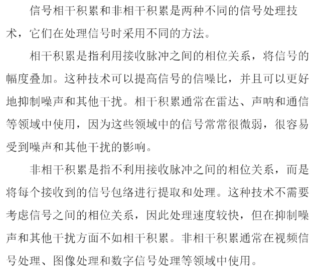
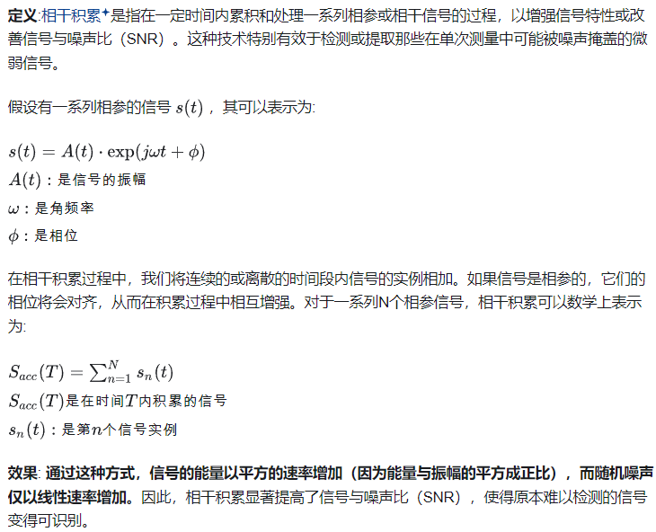
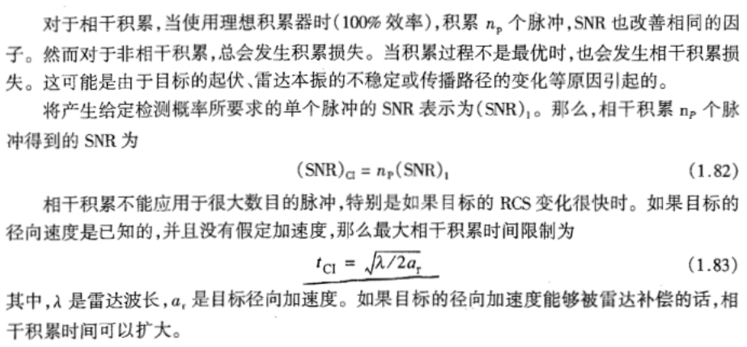
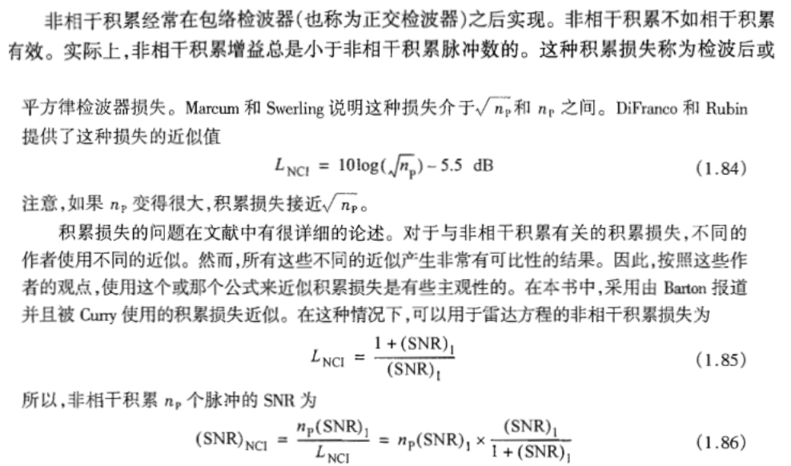
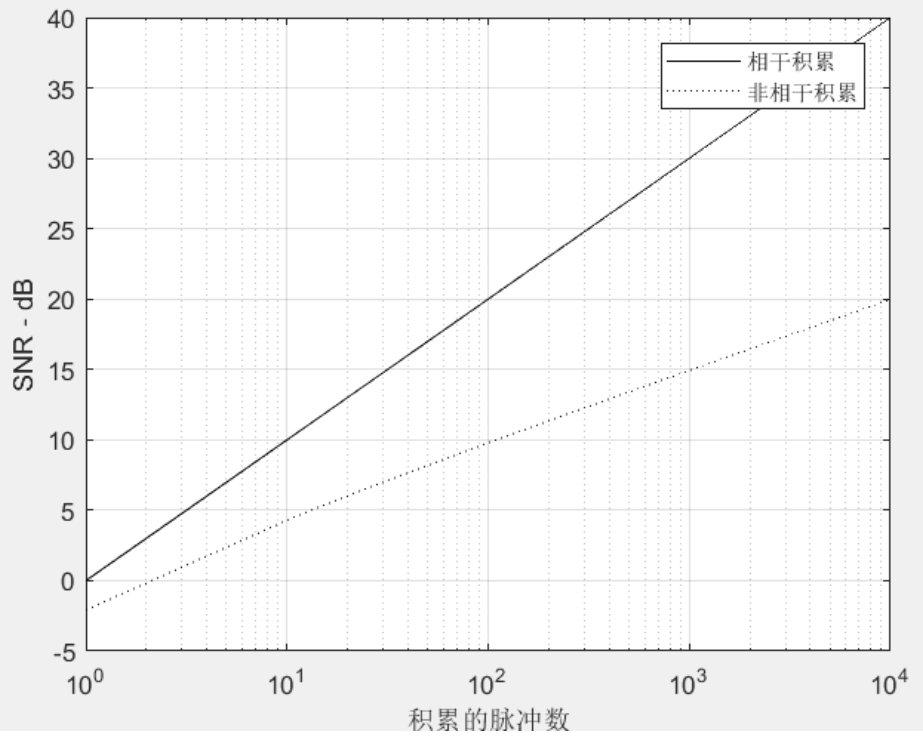
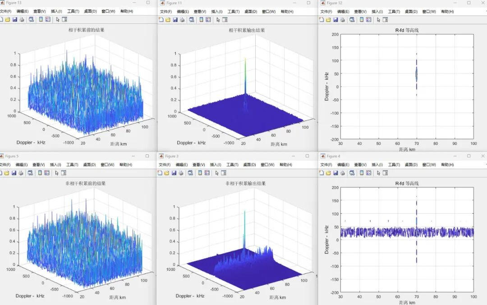

# [Pulse Accumulation]Comparison Study of Coherent and Non-coherent Accumulation in Radar Signal [with MATLAB Code]

Coherent accumulation principle  
Non-coherent accumulation principle
MATLABCode example and simulation results%use thsi figure to generate Fig. 1.21 of text\nclear all\nclose all\nnp = linspace(1,10000,1000);\nsnrci = pulse_integration(4,94.e9,47,20,290,20e6,7,10,5.01e3,np,1);\nsnrnci = pulse_integration(4,94.e9,47,20,290,20e6,7,10,5.01e3,np,2);\nsemilogx(np,snrci,'k',np,snrnci,'k:')\nlegend('Coherent accumulation','Non-coherent accumulation')\ngrid\nxlabel ('Accumulated pulse count');\nylabel ('SNR - dB');\n​\nfunction [snrout] = pulse_integration(pt, freq, g, sigma, te, b, nf, loss, range,np,ci_nci)\n snr1 = radar_eq(pt, freq, g, sigma, te, b, nf, loss, range) % single pulse SNR\n snr1=0\nif (ci_nci == 1) % Coherent accumulation\n   snrout = snr1 + 10*log10(np);\nelse % Non-coherent accumulation\n    if (ci_nci == 2)\n        snr_nci = 10.^(snr1./10);\n        val1 = (snr_nci.^2) ./ (4.*np.*np);\n        val2 = snr_nci ./ np;\n        val3 = snr_nci ./ (2.*np);\n        SNR_1 = val3 + sqrt(val1 + val2); % Equation 1.87 of text\n        LNCI = (1+SNR_1) ./ SNR_1; % Equation 1.85 of text\n        snrout = snr1 + 10*log10(np) - 10*log10(LNCI);\n    end\nend\nreturn\n​\n  

## Images

<!-- PAYMENT_BLOCK -->

## Get this dataset

- Payment link (Stripe): [Buy now](https://buy.stripe.com/3cs8yP7sY87d0vu9AB)
- Payment QR code: 

<!-- /PAYMENT_BLOCK -->
